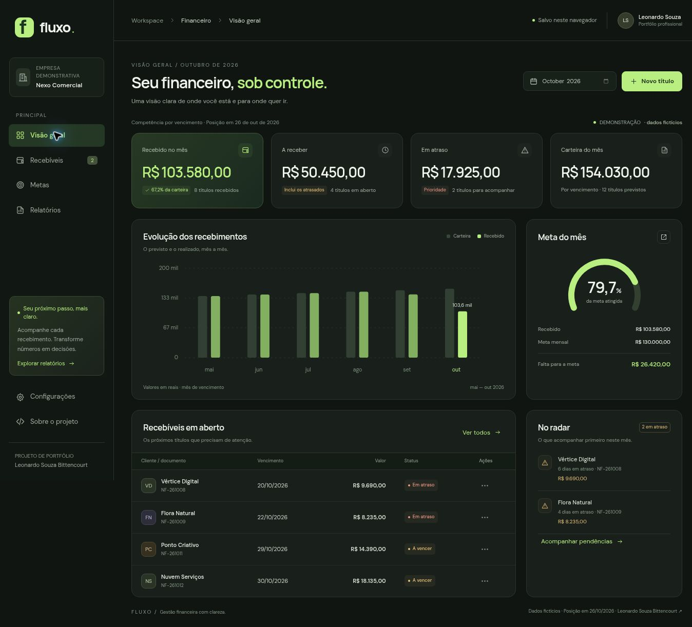

# Fluxo — Gestão Financeira

Sistema web de recebíveis, metas e pendências, criado como projeto de portfólio de **Leonardo Souza Bittencourt**. Uma aplicação prática de tecnologia às rotinas administrativas e financeiras.



**[Abrir demonstração pública](https://leosouzabittencourt-hue.github.io/portfolio/projetos/fluxo/)** · [Portfólio](https://leosouzabittencourt-hue.github.io/portfolio/)

## O problema

Uma lista de boletos informa valores e datas, mas nem sempre mostra o que precisa de atenção primeiro. O Fluxo reúne carteira do mês, recebimentos confirmados, títulos em atraso e metas por categoria em uma única visão.

## Funcionalidades

- Dashboard com carteira, recebido, a receber e atraso.
- Comparativo de seis meses e acompanhamento de metas.
- Cadastro, edição e exclusão de títulos; baixa integral e estorno de recebimentos.
- Busca por cliente, documento e observação, filtros, ordenação e paginação.
- Metas mensais por Locação, Serviços, Mídia e Outros.
- Importação e exportação CSV compatível com separador `;` do Excel em português.
- Relatório para impressão ou salvamento em PDF pelo navegador.
- Backup e restauração completos em JSON, com validação antes de substituir os dados.
- Interface responsiva, navegação por teclado e menu adaptado ao celular.

## Executar no computador

Não há dependências de aplicação para instalar nem etapa de build. Use um servidor HTTP para servir os módulos JavaScript; abrir o HTML diretamente pelo explorador de arquivos não é suficiente.

Na pasta deste projeto, execute com Python 3:

```bash
python -m http.server 8000 --directory dist
```

No Windows, se o comando `python` não existir, use:

```powershell
py -m http.server 8000 --directory dist
```

Abra **http://localhost:8000** no navegador. O comando funciona no Windows, macOS e Linux com Python instalado. As fontes Google são opcionais: a interface usa fontes do sistema quando estiverem indisponíveis.

## Demonstração

A primeira abertura carrega **96 títulos fictícios**, de março a outubro de 2026. A posição inicial é **26/10/2026**; ela é fixa para manter a apresentação reproduzível e pode ser alterada nas configurações.

Em outubro, a carteira inicial soma **R$ 154.030,00**, sendo **R$ 103.580,00 recebidos**, **R$ 50.450,00 em aberto** e **R$ 17.925,00 em atraso**. A meta total é **R$ 130.000,00**. Os valores em atraso estão incluídos no total em aberto.

Para testar:

1. Em **Recebíveis**, clique em **Novo título** e preencha cliente, documento, categoria, vencimento e valor.
2. Abra os detalhes em **Ações** e escolha **Registrar recebimento**.
3. Confira a atualização do painel e das metas.
4. Em **Relatórios**, exporte o CSV ou use **Imprimir / salvar PDF**.
5. Em **Configurações**, exporte um backup antes de restaurar a demonstração.

## Regras dos indicadores

| Indicador | Critério |
| --- | --- |
| Carteira do mês | Soma dos títulos com vencimento no mês selecionado. |
| Recebido no mês | Títulos dessa carteira com recebimento confirmado até a data de referência. |
| A receber | Carteira menos os recebimentos confirmados. Inclui títulos atrasados. |
| Em atraso | Títulos em aberto com vencimento anterior à referência. Vencimento hoje ainda não é atraso. |
| Meta e atingimento | Soma das metas por categoria e comparação com o recebido da mesma carteira. |

O agrupamento é **por mês de vencimento**. Não se trata de um demonstrativo de fluxo de caixa por data de recebimento. A exportação inclui ambas as datas para análises externas. Uma referência anterior ao último recebimento cadastrado é rejeitada, evitando baixas futuras em relação à posição exibida.

Valores são armazenados em **centavos inteiros**, e datas de negócio usam `AAAA-MM-DD`. Não há conversão de fuso para determinar vencimentos.

## Importar CSV

Baixe o modelo em **Recebíveis → Baixar modelo CSV**. As colunas devem aparecer nesta ordem:

```text
Documento;Cliente;Categoria;Vencimento;Valor;Recebimento;Forma;Observação
```

- Valores: `1250,00` ou `1.250,00`, sempre positivos.
- Datas: `AAAA-MM-DD` ou `DD/MM/AAAA`.
- Título em aberto: deixe **Recebimento** e **Forma** vazios.
- Título recebido: preencha a data até a referência e uma forma válida: Pix, Boleto, Transferência, Cartão ou Outro.
- Documentos devem ser únicos, inclusive em relação aos títulos já cadastrados.
- Até 1.000 títulos por arquivo, 2 MB por CSV e 10.000 títulos no total.
- Uma linha inválida rejeita a importação inteira; a base anterior é preservada.

A exportação inclui BOM UTF-8 e neutraliza células de texto que poderiam ser interpretadas como fórmulas por planilhas. O importador não interpreta arquivos XLSX nem layouts de SAP.

## Estrutura técnica

```text
dist/
  index.html       Estrutura semântica e metadados
  styles.css       Tema, responsividade e impressão
  app.js           Interface, eventos e armazenamento
  core.js          Regras financeiras e validações
  seed.js          Base demonstrativa reproduzível
  icons.js         Ícones SVG locais
  favicon.svg      Identidade do projeto
tests/
  finance.test.js  Testes do domínio
docs/
  post-linkedin.md Texto de divulgação e roteiro de demonstração
```

**Tecnologias:** HTML, CSS, JavaScript com ES Modules, SVG e LocalStorage. Testes com o executor nativo do Node.js, sem dependências de terceiros.

## Validação

Com Node.js 20 ou superior:

```bash
npm test
npm run check
```

**16 testes automatizados** cobrem centavos, datas, status, reconciliação dos indicadores, duplicidades, busca, CSV, backup e escape de HTML. Também foram conferidos no navegador cadastro, recebimento, persistência após recarregar, busca, edição de metas, importação, exportação, backup, restauração da demonstração e navegação em largura de celular.

O recurso de impressão oferece o diálogo nativo do navegador. A geração de PDF depende da opção “Salvar como PDF” disponível no computador.

## Escopo

Esta versão é um **protótipo funcional para portfólio**, com empresa, clientes, documentos e valores fictícios. Os dados ficam no navegador e não são compartilhados entre computadores ou usuários. Não há autenticação, banco de dados remoto, processamento de pagamentos, conciliação bancária, trilha de auditoria ou integração com SAP. Limpar os dados do navegador remove os registros locais; o backup permite recuperá-los.

Evoluções possíveis: API e banco de dados, controle de acesso, pagamentos parciais, histórico de alterações e modelo analítico para Power BI. Esses itens ainda não estão implementados.

**Autor do portfólio:** [Leonardo Souza Bittencourt](https://www.linkedin.com/in/leonardo-souza-bittencourt/) · [GitHub](https://github.com/leosouzabittencourt-hue)
